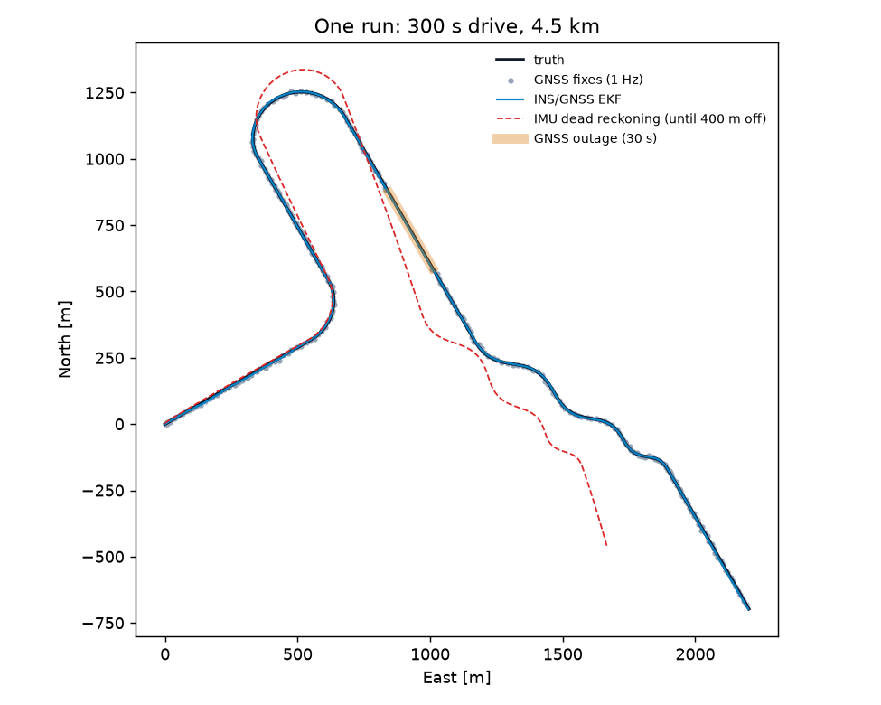
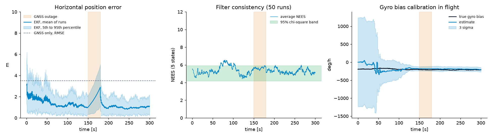

# ins-gnss-fusion

**Loosely coupled INS/GNSS navigation with an extended Kalman filter:** a 100 Hz IMU drives strapdown mechanisation, 1 Hz GNSS fixes correct it, sensor biases are calibrated in motion, and a 30 second GNSS outage is bridged on the calibrated IMU. Validated over 50 Monte Carlo runs with NEES consistency tests.

[](https://github.com/DanielYamanoglu/ins-gnss-fusion/actions/workflows/ci.yml)


> **Simulated sensors, realistic error models.** The trajectory and sensor data are generated: a MEMS-grade IMU with turn-on bias, white noise and bias random walk, and GNSS fixes delivered as latitude and longitude. Because the truth is known exactly, every error can be measured and the filter's own uncertainty can be checked against it.

## Results

50 independent Monte Carlo runs of a 300 s, 4.5 km drive (acceleration, a 90° and a 180° turn, slalom, speed changes), with a 30 s GNSS outage from t = 150 s. Steady-state numbers exclude the first 20 s and the 20 s after the outage.

| | Value |
|---|---|
| Horizontal position RMSE, INS/GNSS EKF | **1.38 m** |
| Horizontal position RMSE, GNSS fixes alone | 3.53 m |
| Velocity RMSE | 0.19 m/s |
| Heading RMSE | 1.37° |
| Position error after 30 s without GNSS (mean / 95th percentile) | **2.9 m / 5.0 m** |
| Uncalibrated IMU dead reckoning after the same 30 s | 37.9 m |
| Gyro bias error, start → end | 301 → 15 deg/h |
| Average NEES (5 navigation states, expected 5) | 5.33, inside the 95% band 87% of the time |





What the numbers say:

- **Fusion beats either sensor alone.** The filter cuts GNSS noise by 61%, and pure dead reckoning with the same IMU is more than 100 m off within a minute.
- **The outage is bridged because the biases were learned.** After 30 s without GNSS the filter is 2.9 m off on average; integrating the same IMU without calibration drifts 38 m over the same 30 s.
- **Gyro bias only becomes observable when the vehicle turns.** On the straight first 40 s the bias uncertainty barely moves; the 90° turn at t = 40 s collapses it (right panel).
- **The filter's uncertainty is honest.** Average NEES is 5.3 against an expected 5, so the reported covariance can be trusted for integrity checks and for gating GNSS outliers.

## How it works

- **Coordinates** ([`geodesy.py`](src/insgnss/geodesy.py)): WGS-84 geodetic to ECEF to a local East-North-Up frame and back; GNSS fixes arrive as latitude and longitude and are converted before the update.
- **Sensor models** ([`simulate.py`](src/insgnss/simulate.py)): accelerometer and gyro with turn-on bias, white noise and bias random walk; GNSS with 2.5 m noise per axis at 1 Hz and a configurable outage. The true trajectory is integrated with the same scheme the filter uses, so error-free sensors reproduce it exactly (checked by a test).
- **Filter** ([`ekf.py`](src/insgnss/ekf.py)): 8 states (position, velocity, heading, two accelerometer biases, gyro bias). Strapdown mechanisation rotates the bias-corrected specific force into the navigation frame; the covariance is propagated with the analytic Jacobian, and GNSS updates use the Joseph form to keep it symmetric and positive definite.
- **Evaluation** ([`evaluate.py`](src/insgnss/evaluate.py), [`report.py`](src/insgnss/report.py)): Monte Carlo with independent sensor and initialisation errors per run, dead reckoning and GNSS-only baselines, NEES against a chi-square band.

## Quickstart

```bash
uv sync
uv run pytest
uv run insgnss --runs 50      # writes reports/metrics.json and figures (about 80 s)
```

## Project structure

```
src/insgnss/geodesy.py    WGS-84 geodetic, ECEF and ENU conversions
src/insgnss/simulate.py   trajectory, IMU and GNSS error models, outage
src/insgnss/ekf.py        strapdown mechanisation, Jacobian, process noise, GNSS update
src/insgnss/evaluate.py   filter runs, dead reckoning baseline, Monte Carlo
src/insgnss/report.py     summary metrics, chi-square band, figures
tests/                    7 tests: geodesy round trip, exact mechanisation, Jacobian vs finite
                          differences, valid covariance, outage bridging, NEES consistency
```

## Limitations

- **Planar motion.** Heading is the only attitude angle; roll, pitch, gravity compensation and Earth rotation are not modelled. A full 3D strapdown with quaternions is the natural next step.
- **Simulated data.** Real sensors add scale factor errors, misalignment, temperature effects and GNSS multipath; none are modelled.
- **Loosely coupled.** GNSS enters as position fixes; a tightly coupled filter using pseudoranges would keep working with fewer than four satellites.

## What I'd do next

- 3D error-state filter with quaternion attitude, gravity and Earth rate.
- Run it on a public dataset with real IMU and GNSS logs (for example KITTI) and compare against the reference solution.
- GNSS outlier rejection with innovation gating, and an RTS smoother for post-processing.
- Port the filter core to C++ for embedded use.

## License

MIT. See [LICENSE](LICENSE).
