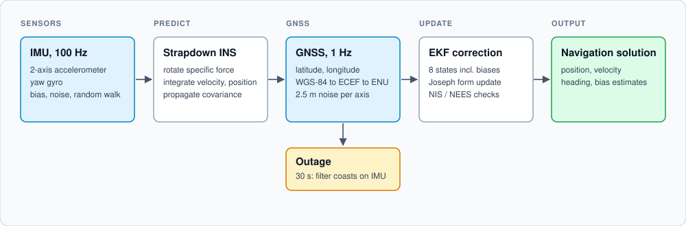

# ins-gnss-fusion

**Loosely coupled 3D INS/GNSS navigation for a small fixed-wing UAV:** static coarse alignment, quaternion strapdown mechanisation in a local NED frame, a 15-state error-state Kalman filter that calibrates the IMU biases in flight, chi-square gating against GNSS multipath and spoofing jumps, and a 60 s GNSS outage bridged on the calibrated IMU. Validated over 50 Monte Carlo runs with NEES consistency tests.

[](https://github.com/DanielYamanoglu/ins-gnss-fusion/actions/workflows/ci.yml)




> **Simulated sensors, independent truth.** The flight is generated at 1 kHz from smooth speed, heading and climb profiles with coordinated-turn attitude, independently of the filter; the IMU reports 100 Hz averages of that truth plus datasheet-style errors. Error-free sensors leave a 1.4 m discretisation error after 10.8 km, so the filter faces real model mismatch, not its own equations.

## Results

50 Monte Carlo runs of a 330 s, 10.8 km flight: 10 s on the ground, take-off, climb to 110 m, a 90° and a 180° banked turn (up to 31° roll), descent, S-turns. GNSS is lost for 60 s from t = 180 s, during the descent. 3% of fixes carry a 30 m multipath or spoofing jump.

IMU class (industrial MEMS, not a specific product): gyro ARW 0.3°/√h, turn-on bias 50°/h (1σ), rate random walk 2°/h/√h; accelerometer VRW 0.1 m/s/√h, turn-on bias 2 mg (1σ). GNSS: 2 m horizontal, 4 m vertical, 0.1 m/s velocity (1σ).

| | Value |
|---|---|
| Horizontal position RMSE, INS/GNSS | **0.64 m** |
| Horizontal position RMSE, GNSS alone (valid fixes / all fixes) | 2.83 m / 6.02 m |
| Velocity RMSE | 0.07 m/s |
| Roll and pitch RMSE / yaw RMSE | **0.10° / 0.29°** |
| Horizontal error after 60 s without GNSS (mean / 95th percentile) | **14.0 m / 26.8 m** |
| Levelled but uncalibrated IMU after the same 60 s | 134 m |
| Gyro bias error (3 axes), after alignment → end | 79 → 2.4 °/h |
| GNSS jumps rejected by the gate / valid fixes wrongly rejected | **413 of 413 (100%)** / 13 of 12,837 (0.1%) |
| Horizontal RMSE with / without the gate (20 runs) | 0.65 m / 1.13 m |
| Average NEES (9 navigation states, expected 9) | **9.10**, inside the 95% band 92% of the time |


What the numbers say:

- **The outage is bridged because the biases were learned in flight.** A levelled IMU without calibration drifts 134 m in 60 s; the filter, coasting on biases it estimated before the outage, is 14 m off on average.
- **Heading and the vertical gyro bias need manoeuvres.** Yaw starts with the 3° launch-azimuth uncertainty and only converges once the vehicle accelerates and turns; the z-axis gyro bias barely moves until the first banked turn at t = 80 s (bottom right).
- **The gate behaves as designed.** It is set at the 99.9% chi-square point for six measurements and rejects 0.1% of valid fixes, exactly that rate, while catching every 30 m jump the filter was offered, including those right after the outage when its own uncertainty is largest. Without it, the jumps nearly double the position error.
- **The covariance is honest.** Average NEES 9.1 against an expected 9 with an independent truth means the reported uncertainty can drive integrity checks and the outlier gate itself.

## How it works

- **Alignment** ([`alignment.py`](src/insgnss/alignment.py)): roll and pitch from the mean specific force over 5 s at rest. A MEMS gyro cannot sense Earth rate, so heading comes from a launch azimuth (3°, 1σ) and is refined in flight.
- **Mechanisation** ([`ekf.py`](src/insgnss/ekf.py)): bias-corrected specific force rotated to NED plus gravity, second-order position update, quaternion attitude update.
- **Error-state filter**: 15 states (position, velocity, attitude error, accelerometer and gyro biases). Analytic transition matrix, process noise from the datasheet densities, Joseph-form update, error injection into the nominal state after each fix.
- **GNSS** ([`sensors.py`](src/insgnss/sensors.py)): position as latitude, longitude and height through WGS-84 → ECEF → NED ([`geodesy.py`](src/insgnss/geodesy.py)), plus velocity; each fix is accepted only if its normalised innovation squared passes the gate.
- **Truth** ([`trajectory.py`](src/insgnss/trajectory.py)): C2-smooth profiles, coordinated-turn roll, specific force and angular rate obtained by differentiating the 1 kHz truth.
- **Evaluation** ([`evaluate.py`](src/insgnss/evaluate.py), [`report.py`](src/insgnss/report.py)): independent sensor and initialisation errors per run, baselines, NEES against a chi-square band, gate confusion counts.

Earth rotation and transport rate are neglected: over 10 km and with a 50°/h gyro they are well below the sensor errors.

## Quickstart

```bash
uv sync
uv run pytest
uv run insgnss --runs 50      # writes reports/metrics.json and figures (about 3.5 min)
```

## Project structure

```
src/insgnss/geodesy.py     WGS-84 geodetic, ECEF, ENU and NED conversions
src/insgnss/rotations.py   SO(3) exponential and logarithm, quaternions, Euler angles
src/insgnss/trajectory.py  1 kHz UAV truth with coordinated turns
src/insgnss/sensors.py     IMU in datasheet units, GNSS position and velocity, outliers, outage
src/insgnss/alignment.py   static levelling
src/insgnss/ekf.py         strapdown mechanisation, error-state Jacobian, gated GNSS update
src/insgnss/evaluate.py    filter runs, dead reckoning, Monte Carlo
src/insgnss/report.py      metrics, chi-square band, figures
tests/                     9 tests: geodesy and rotation round trips, truth physics, discretisation error
                           of error-free sensors, error-state Jacobian against finite perturbations,
                           levelling, gate, outage bridging, NEES consistency
```

## Limitations

- **Simulated data.** Scale factor errors, misalignment, g-sensitivity, vibration, coning and sculling, and time-correlated GNSS errors are not modelled.
- **Loosely coupled.** GNSS enters as position and velocity; a tightly coupled filter using pseudoranges keeps working with fewer than four satellites and can gate individual satellites.
- **Flat-Earth navigation frame.** Fine over tens of kilometres; long-range navigation needs Earth rate, transport rate and a curvilinear position state.
- **No magnetometer or gyrocompassing**, so initial heading relies on an external azimuth.

## What I'd do next

- Run it on a public dataset with real IMU and GNSS logs and compare against the reference solution.
- Tightly coupled pseudorange updates and receiver autonomous integrity monitoring (RAIM).
- RTS smoother for post-processing and a 21-state model with scale factors.
- C++ port of the filter core for embedded targets.

## License

MIT. See [LICENSE](LICENSE).
